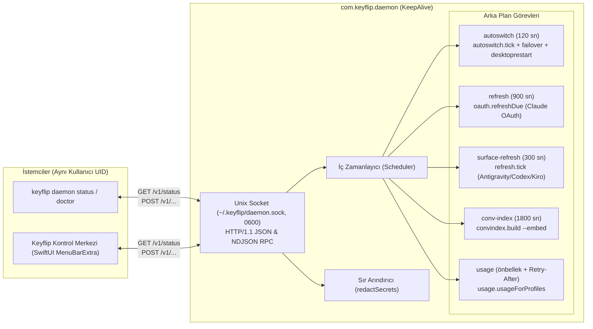

# Keyflip Tekil Denetimli Daemon (`keyflip daemon`) Tasarımı

Bu belge, dağınık arka plan işlerini tek bir denetimli süreçte (`com.keyflip.daemon`) birleştiren ve yerel durum/kontrol soketi sunan `keyflip daemon` mimarisini tanımlar.

---

## 1. Sorun ve Amaç

Önceki mimaride 4 ayrı `launchd` işi birbirinden habersiz çalışıyordu:

| Eski Plist Etiketi | Aralık / Kip | Yaptığı İş | Sorunlar |
|---|---|---|---|
| `com.keyflip.refresh` | `StartInterval=900` (15 dk) | `keyflip refresh --all --due` (Claude OAuth token yenileme) | Ayrı süreç, `autoswitch` ile çakışma olasılığı |
| `com.keyflip.refresh-daemon` | `KeepAlive=true` | `keyflip-refresh.js` (Antigravity, Codex, Kiro yenileme) | İkinci bir `KeepAlive` süreci, ayrı metrik dosyası |
| `com.keyflip.autoswitch` | `StartInterval=120` (2 dk) | `keyflip autoswitch --once -y --threshold 95 --strategy best` | Her 2 dakikada yeni Node süreci, hız sınırı/kota okuma koordinasyonsuzluğu |
| `com.keyflip.conv-index` | `StartInterval=1800` (30 dk) | `keyflip conv index --embed` | Ayrı süreç, durumunun menü çubuğundan izlenememesi |

**Hedef mimari (`com.keyflip.daemon`):**
1. **Tek `launchd` birimi**: `~/Library/LaunchAgents/com.keyflip.daemon.plist` (`KeepAlive: true`, `RunAtLoad: true`). Çökerse `launchd` tarafından otomatik yeniden başlatılır (`ThrottleInterval: 10`).
2. **Sabit (non-ephemeral) Node yolu**: `src/selfbin.js` (`resolveSelf()` + `jobPath()`) kullanılarak geçici `fnm_multishells` yolları yerine kalıcı Node ikilisi ve betik yolu plist'e yazılır.
3. **İç zamanlayıcı (Internal Scheduler)**: Token yenileme, otomatik geçiş / failover tetikleme, konuşma indeksleme ve kullanım okuma işlerini tek süreç içinde, görev bazlı kilitlerle (non-overlapping) ve ortak hız sınırı (`Retry-After` / `.usage-throttle.json`) penceresine saygı duyarak çalıştırır.
4. **Yerel Durum ve Kontrol API'si**: `~/.keyflip/daemon.sock` (`0600` izinli Unix domain socket) üzerinden hem CLI (`keyflip daemon status`, `keyflip doctor`) hem de macOS menü çubuğu uygulaması (`apps/menubar`) için sıfır-sır (zero-secret) JSON protokolü sunar.
5. **Dönen günlük (Rotating log)**: `~/Library/Logs/keyflip-daemon.log` dosyasını boyut sınırına (varsayılan 5 MiB) ulaştığında `.1` yedeğine döndürerek diskin dolmasını önler.

---

## 2. Mimari ve Veri Akışı



---

## 3. İç Zamanlayıcı (Scheduler) ve Görevler

Her görev kendi zamanlayıcısına ve **çakışma önleyici kilidine (`inFlight`)** sahiptir. Bir görev hâlâ çalışıyorsa yeni tik üst üste binmez; tamamlandığında `lastRunAt`, `lastDurationMs`, `lastResult`, `lastError` ve `runCount` güncellenir ve `~/.keyflip/.daemon-state.json` (`0600`) dosyasına atomik olarak yazılır.

| Görev Anahtarı | Varsayılan Aralık | Yapılandırma Anahtarı | Çağrılan Modül / İşlev | Açıklama |
|---|---|---|---|---|
| `autoswitch` | `120` sn (2 dk) | `daemon.autoswitchIntervalSeconds` | `autoswitch.tick` + `desktoprestart.processPending` | Aktif hesabın kullanımını ve `limitsignal` transkript sinyallerini izler; eşik (`autoswitch.threshold`, varsayılan %95) aşıldığında uygun hesaba geçer veya tüm hesaplar doluysa `keysmith` API failover'ı (`failover.engage`) devreye sokar. Claude Desktop boşta ise (`desktoprestart`) yeniden başlatır. |
| `refresh` | `900` sn (15 dk) | `daemon.refreshIntervalSeconds` | `oauth.refreshDue` | Kayıtlı ve o an aktif olmayan Claude hesaplarının süresi yaklaşan (`refresh.leadMinutes`, varsayılan 60 dk) OAuth tokenlarını yeniler. Sonuçları `refresh-state.json` içine yazar. |
| `surface-refresh` | `300` sn (5 dk) | `daemon.surfaceRefreshIntervalSeconds` | `refresh.tick` | Antigravity ve canlı ChatGPT/Codex OAuth tokenlarını proaktif yeniler; Kiro token özetini kontrol eder. Metrikleri `refresh-metrics.json` içine yazar. |
| `conv-index` | `1800` sn (30 dk) | `daemon.convIndexIntervalSeconds` | `convindex.build({ embed: true })` | Claude/Codex konuşmalarını artımlı olarak indeksler ve gömme (embedding) vektörlerini günceller. |
| `usage` | `autoswitch` ile birlikte veya isteğe bağlı | `usage.cacheTtlSeconds` (60 sn) | `usage.usageForProfiles` | `.usage-cache.json` ve `.usage-throttle.json` üzerinden kota bilgilerini okur. Sunucu `429` veya `Retry-After` döndürdüğünde sessiz pencere (`retryAt`) dolana kadar hiçbir görev yeni ağ isteği yapmaz. |

---

## 4. Yerel Durum ve Kontrol API'si (`~/.keyflip/daemon.sock`)

### 4.1 Taşıma Katmanı ve İzinler
- **Soket Yolu**: `<configDir>/daemon.sock` (varsayılan `~/.keyflip/daemon.sock`).
- **Dosya İzinleri**: Soket oluşturulmadan önce dizin `0700`, soket dosyası `0600` (`chmodSync(socketPath, 0o600)`) olarak ayarlanır. Yalnızca aynı Unix kullanıcısı (`uid`) bağlanabilir.
- **Çift Protokol Desteği (HTTP/1.1 + NDJSON)**:
  - `curl --unix-socket ~/.keyflip/daemon.sock http://localhost/v1/status` veya Swift `URLSession` / HTTP istemcileri için standart HTTP/1.1 (`GET /v1/status`, `POST /v1/switch`, vb.).
  - Düşük seviyeli POSIX soket istemcileri için tek satırlık JSON-RPC (`{"cmd":"status"}\n` -> `{"ok":true,...}\n`). Bağlantının ilk baytı `{` ise JSON satırı, HTTP metodu ise HTTP/1.1 olarak işlenir.

### 4.2 Uç Noktalar (Endpoints) ve Komutlar

#### 1. `GET /v1/status` (veya `{"cmd": "status"}`)
Anlık durumu (önbellekten, ağ bloklaması yapmadan) döndürür:

```json
{
  "ok": true,
  "daemon": {
    "pid": 48210,
    "startedAt": "2026-11-13T12:30:00.000Z",
    "uptimeSeconds": 3600,
    "version": "0.1.0",
    "socketPath": "/Users/hakkisagdic/.keyflip/daemon.sock",
    "logPath": "/Users/hakkisagdic/Library/Logs/keyflip-daemon.log"
  },
  "activeAccount": {
    "name": "gmail",
    "email": "user@gmail.com",
    "tier": "max20x"
  },
  "accounts": [
    {
      "name": "gmail",
      "email": "user@gmail.com",
      "tier": "max20x",
      "enabled": true,
      "active": true,
      "token": {
        "status": "valid",
        "expiresAt": "2026-11-13T20:00:00.000Z",
        "remainingMs": 27000000,
        "refreshable": true,
        "lastResult": "ok",
        "lastRefreshAt": "2026-11-13T12:15:00.000Z",
        "lastError": null
      },
      "usage": {
        "fiveHour": { "pct": 42, "resetsAt": "2026-11-13T16:00:00.000Z" },
        "sevenDay": { "pct": 61, "resetsAt": "2026-11-18T00:00:00.000Z" },
        "sevenDaySonnet": null,
        "extraUsage": null,
        "effectiveHeadroom": 39,
        "stale": false,
        "fetchedAt": "2026-11-13T12:29:00.000Z"
      }
    }
  ],
  "usageThrottle": {
    "throttled": false,
    "retryAt": null,
    "strike": 0
  },
  "failover": {
    "enabled": true,
    "engaged": false,
    "manual": false,
    "since": null,
    "fromAccount": null,
    "reason": null,
    "recoverAt": null,
    "alias": "claude-failover",
    "legs": ["anthropic-api", "openrouter"],
    "gatewayUrl": "http://127.0.0.1:8787",
    "gatewayReady": true,
    "gatewayReason": null,
    "cap": {
      "max": 25,
      "spent": 1.42,
      "remaining": 23.58,
      "period": "month",
      "exceeded": false,
      "windowStatus": "ok"
    }
  },
  "desktopRestart": {
    "pending": false,
    "since": null,
    "actions": []
  },
  "jobs": {
    "autoswitch": {
      "intervalSeconds": 120,
      "running": false,
      "lastRunAt": "2026-11-13T12:28:00.000Z",
      "lastDurationMs": 145,
      "lastResult": "below",
      "lastError": null,
      "runCount": 30
    },
    "refresh": {
      "intervalSeconds": 900,
      "running": false,
      "lastRunAt": "2026-11-13T12:15:00.000Z",
      "lastDurationMs": 320,
      "lastResult": "ok",
      "lastError": null,
      "runCount": 4
    },
    "surface-refresh": {
      "intervalSeconds": 300,
      "running": false,
      "lastRunAt": "2026-11-13T12:25:00.000Z",
      "lastDurationMs": 80,
      "lastResult": "ok",
      "lastError": null,
      "runCount": 12
    },
    "conv-index": {
      "intervalSeconds": 1800,
      "running": false,
      "lastRunAt": "2026-11-13T12:00:00.000Z",
      "lastDurationMs": 910,
      "lastResult": "ok",
      "lastError": null,
      "runCount": 2
    }
  },
  "warnings": [],
  "config": {
    "autoswitch.threshold": 95,
    "autoswitch.strategy": "best",
    "refresh.leadMinutes": 60,
    "failover.enabled": true,
    "failover.capUsd": 25,
    "notify.desktop": false,
    "desktop.autoRestart": true
  }
}
```

#### 2. `POST /v1/switch` (veya `{"cmd": "switch", "account": "<isim>", "confirm": true, "reason": "menubar"}`)
- `confirm: true` zorunludur; aksi halde `400 Bad Request` (`confirmation_required`) döner.
- `core.performSwitch(ctx, account)` ile hesabı değiştirir, `log.log` ve `history.recordEvent` ile denetim izi (audit log) yazar.

#### 3. `POST /v1/failover` (veya `{"cmd": "failover", "action": "on"|"off", "confirm": true, "reason": "menubar"}`)
- `confirm: true` zorunludur.
- `action: "on"` ise `failover.engage(ctx, { manual: true, reason })`, `"off"` ise `failover.release(ctx, { reason })` çağrılır ve denetim izine kaydedilir.

#### 4. `POST /v1/run-now` (veya `{"cmd": "run-now", "job": "autoswitch"|"refresh"|"surface-refresh"|"conv-index"|"usage"}`)
- İlgili görevi hemen tetikler (`Retry-After` sessiz penceresini koruyarak) ve güncel görev sonucunu döndürür.

#### 5. `POST /v1/config` (veya `{"cmd": "config", "set": {"autoswitch.threshold": 90}, "confirm": true}`)
- `src/config.js` şeması üzerinden doğrulayarak tercihleri günceller ve denetim izine yazar.

---

## 5. Güvenlik Sınırları (Security Invariants)

1. **Soket Üzerinden Asla Sır Dönmez**:
   - OAuth `accessToken`, `refreshToken`, `sessionKey`, çerez değerleri, API anahtarları veya ham kimlik doğrulama başlıkları hiçbir zaman durum nesnesine eklenmez.
   - Ek güvenlik katmanı olarak her yanıt serileştirilmeden önce `redactSecrets(payload)` işlevinden geçirilir; `accessToken`, `refreshToken`, `sessionKey`, `apiKey`, `secret`, `password`, `authorization`, `cookie` isimli alanlar ve `sk-ant-` / `eyJ` ile başlayan değerler otomatik olarak maskelenir.
2. **İzin Sınırı**:
   - `~/.keyflip/daemon.sock` `0600` kipiyle açılır.
   - `~/.keyflip/.daemon-state.json` ve `~/.keyflip/.daemon-install.json` `0600` kipiyle yazılır ve `profiles.RESERVED_FILES` içinde rezerve edilir (veya nokta önekli tutulur).
3. **Eylem Onayı ve Denetim İzi (Audit Log)**:
   - Durum değiştiren her komut (`switch`, `failover`, `config`) `confirm: true` parametresi olmadan reddedilir ve `~/.keyflip/logs/keyflip.log` ile `history.jsonl` dosyalarına zaman damgalı kayıt bırakır.

---

## 6. Kurulum, Göç (Migration) ve Geri Dönüş (Rollback)

### 6.1 Eski 4 `launchd` İşinin Kaldırılması ve Yedeklenmesi
`keyflip daemon install` çalıştırıldığında şu 4 eski plist taranır:
- `~/Library/LaunchAgents/com.keyflip.refresh.plist`
- `~/Library/LaunchAgents/com.keyflip.refresh-daemon.plist`
- `~/Library/LaunchAgents/com.keyflip.autoswitch.plist`
- `~/Library/LaunchAgents/com.keyflip.conv-index.plist`

Varsa:
1. Dosyalar `~/.keyflip/backups/legacy-launchd/<ISO-timestamp>/` dizinine kopyalanır.
2. Aynı dizine nasıl geri yükleneceğini anlatan `ROLLBACK.md` yazılır.
3. `launchctl unload -w <plist>` ile durdurulur ve `~/Library/LaunchAgents/` altından silinir.
4. Yeni `~/Library/LaunchAgents/com.keyflip.daemon.plist` yazılıp `launchctl load -w` ile devreye alınır.

### 6.2 Geri Dönüş (Rollback)
Kullanıcı tekil daemon'dan eski düzene dönmek isterse:
```bash
keyflip daemon uninstall
cp ~/.keyflip/backups/legacy-launchd/<timestamp>/*.plist ~/Library/LaunchAgents/
for f in ~/Library/LaunchAgents/com.keyflip.*.plist; do launchctl load -w "$f"; done
```

---

## 7. `keyflip doctor` Entegrasyonu

`src/doctor.js` içine `daemonService(ctx, add, opts)` kontrolü eklenir:
- `com.keyflip.daemon` kurulu ve `launchd` tarafından yüklü mü?
- `~/.keyflip/daemon.sock` mevcut ve son görev çalışmaları zamanında gerçekleşmiş mi?
- Eski 4 plist'ten (`com.keyflip.refresh`, `com.keyflip.refresh-daemon`, `com.keyflip.autoswitch`, `com.keyflip.conv-index`) herhangi biri hâlâ `~/Library/LaunchAgents` altında unutulmuş ve çifte çalışmaya yol açıyor mu? Varsa uyarı (`warn`) verir ve `keyflip daemon install -y` ile temizlenmesini önerir.
