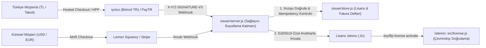

# keyflip — Gelir Modeli ve Ticari Mimari (`keyflip license`)

> **Tarih:** 13 Kasım 2026  
> **Merkezi Mekanizma:** `keyflip license` — Sıfır telemetri ve çevrimdışı (air-gapped) çalışma sözünü bozmayan **Ed25519 imzalı lisans jetonu** (`src/license.js`) ve sağlayıcı soyutlamalı **iyzico + MoR** lisans üretici servisi (`issuer/`).

---

## 1. Kim Öder, Neye Öder? (Hedef Müşteri Dilimleri)

| Dilim | Profil | Temel Acı Noktası | Neye Para Öder? (`keyflip license` Değeri) |
|---|---|---|---|
| **1. Power Indie & Danışman Geliştirici** | Aynı anda 2–4 adet Claude Pro/Max ($20–$200/ay), Cursor, Codex ve API anahtarı kullanan yoğun AI geliştiricisi | 5 saatlik kota dolduğunda işin durması, orta turda hesap değişince prompt-cache'in yanıp faturanın 5x katlanması, kontrolsüz ajan döngülerinde API bakiyesinin erimesi | **Pro Lisans:** Otomatik tur-sınırı (cache-warm) hesap rotasyonu, sanal anahtar bütçe tavanı (`Virtual Keys`), semantik önbellek tasarrufu, canlı maliyet ve kota uyarıları |
| **2. AI-Native Yazılım Ajansı & Startup Ekibi (3–25 Kişi)** | Müşteri projeleri için birden fazla AI aboneliğini ve API sağlayıcısını paylaşan mühendislik ekipleri | Hangi projenin/mühendisin ne kadar token harcadığının bilinmemesi, `.env` içinden sızan API anahtarları, ajanların müşteri PII verisini LLM'e göndermesi | **Team Lisans:** Takım anahtar havuzu (`teampool` RBAC), gerçek zamanlı giden PII/sır maskeleme guardrail'i, 1Password/Bitwarden kasa entegrasyonu (`vault`), sanal anahtar bazlı proje bütçeleri |
| **3. Kurumsal Ar-Ge / Platform Mühendisliği (25–250 Kişi)** | Çoklu IDE/CLI ajanını (Claude Code, Cursor, Windsurf, Kiro, Copilot) standartlaştırmak isteyen teknoloji şirketleri | LiteLLM/Portkey gibi bulut veya ağır PostgreSQL/Redis yığınlarını her geliştirici makinesinde yaşatmanın operasyonel maliyeti ve tedarik zinciri riski | **Team / Enterprise Lisans:** Sıfır bağımlılıklı yerel proxy, merkezi politika motoru (`policy`), imzalı filo yönetimi (`fleet` / `swarm`), Git commit ↔ ajan konuşması denetim izi (`conv why`) |
| **4. Regüle / Kapalı Ağ (Air-Gapped) Kurumlar (Finans, Savunma, Hukuk)** | Dış ağa telemetri veya bulut logu çıkaramayan kurumlar | Bulut tabanlı AI gateway'lerin (OpenRouter, Helicone Cloud, Portkey Cloud) KVKK / BDDK / ISO 27001 nedeniyle yasak olması | **Enterprise Lisans:** %100 çevrimdışı çalışan Ed25519 lisans doğrulama, kurum içi lisans üretici (`issuer/`), yerel denetim ve fatura kaydı |

---

## 2. Paketler, Fiyatlandırma (TL + USD) ve Ücretsiz / Ücretli Ayrımı

### 2.1. Paket ve Fiyat Tablosu

| Paket | Aylık Fiyat (TR / Küresel) | Yıllık Fiyat (2 Ay Bedava — %17 İndirim) | Koltuk / Cihaz Kapsamı | Kimler İçin? |
|---|---|---|---|---|
| **Free (Açık Çekirdek)** | **0 ₺ / $0** | **0 ₺ / $0** | 1 geliştirici, 3 makineye kadar | Bireysel başlangıç, manuel hesap geçişi ve temel konuşma arama (dağıtım hunisi) |
| **Trial (14 Günlük Pro Deneme)** | **0 ₺ / $0** (14 gün) | — | 1 geliştirici (`tier: "pro"`, `trial: true`, 14 gün süreli imzalı jeton) | Satın alma öncesi tüm Pro özelliklerini (`keyflip license trial`) sıfır kredi kartı sürtünmesiyle deneyen kullanıcılar |
| **Pro** | **349 ₺/ay** / **$12/ay** | **3.490 ₺/yıl** (~290 ₺/ay) / **$120/yıl** ($10/ay) | 1 geliştirici, 5 makineye kadar (`seats: 1`) | Çoklu abonelik/API kullanan profesyonel geliştiriciler |
| **Team** | **299 ₺/koltuk/ay** / **$10/koltuk/ay** *(min. 3 koltuk = 897 ₺ / $30)* | **2.990 ₺/koltuk/yıl** / **$100/koltuk/yıl** *(min. 3 koltuk)* | Koltuk başına 3 makine (`seats: N`), merkezi takım politikası | Ajanslar, startup'lar ve paylaşımlı anahtar havuzu kullanan ekipler |
| **Enterprise** | **Özel Teklif** *(taban: 29.900 ₺/yıl veya $1.200/yıl, 15+ koltuk)* | Yıllık sözleşme + e-Fatura | Sınırsız iç makine veya kendi `issuer` sunucusu | Kurumsal BT, finans, savunma ve regüle şirketler |

### 2.2. Net Ücretsiz vs. Ücretli Ayrımı (`src/license.js` Kapıları)

| Katman | Açılan Modüller ve Komutlar (`keyflip license` Kapısı) |
|---|---|
| **Free (`free`)** | Manuel hesap geçişi (`switch`, `add`, `list`), 16+ CLI/IDE yüzey geçişi (`surface`), temel kota görünümü (`usage`), temel failover proxy (`proxy start/stop`), oturum listeleme ve konuşma arama (`sessions`, `conv search`), yedekleme ve göç (`backup`, `migrate`), temel MCP araçları |
| **Pro (`pro`)** | • **Maliyet & Bütçe Zekâsı (`cost`, `budget`):** Gerçek zamanlı USD/TL harcama tahmini, 5s/7g kota tavanı, **Sanal Anahtarlar (`vk_...`) ve anahtar/model bazlı bütçe + geçici bütçe artışı** • **Akıllı Yönlendirme & Önbellek (`router`, `cache`):** Bileşik yönlendirme (fiyat + gecikme + 429 skoru), semantik/içerik önbelleği ve **kazanılan USD/TL tasarruf sayacı** • **Önbellek Dostu Otomatik Geçiş (`autoswitch`):** Prompt-cache sıcaklığını koruyan tur sınırı (turn-boundary) otomatik hesap değişimi • **Çoklu Ajan Orkestrasyonu & Filo (`orchestrator`, `jobs`, `fanout`, `fleet`, `notify`):** Paralel ajan işleri, Slack/Discord/Webhook bildirimleri, **Git Commit ↔ Konuşma İlişkilendirme (`conv why`) ve Oturum Verimlilik Skoru** |
| **Team (`team`)** | *Tüm Pro özelliklerine ek olarak:* • **Takım Anahtar Havuzu (`teampool`):** RBAC (`admin`/`member`/`readonly`), ortak kota/anahtar paylaşımı • **Canlı Proxy Guardrail & Politika Motoru (`policy`):** Giden (outbound) isteklerde gerçek zamanlı PII ve API anahtarı sızıntısı engelleme/maskeleme, model/bütçe kuralları • **Kurumsal Sır Kasası (`vault`):** 1Password (`op`) ve Bitwarden (`bw`) kasa arka ucu • **Filo Üzerinde Dağıtık Çalıştırma (`swarm`):** İmzalı uzak ajan görevleri ve birleşik denetim izi (audit log) |
| **Enterprise (`enterprise`)** | *Tüm Team özelliklerine ek olarak:* • Kurum içi (self-hosted) Ed25519 Lisans Üretici (`issuer/`), özel SAML/OIDC SSO entegrasyon rehberi, SLA ve e-Fatura/kurumsal satın alma desteği |

---

## 3. Gelir Artıran İlk 3 Kaldıraç

1. **Kaldıraç 1 — "Kazandırdığı Parayı Gösteren" ROI Sayacı ve 14 Günlük Yerel Deneme (`keyflip license trial` → Yıllık Plan Dönüşümü):**
   - `keyflip` yerel proxy ve önbellek üzerinden geçen her çağrıda **"Önbellekten Kazanılan Tutar ($/₺)"**, **"Önlenen 429 Kesintisi"** ve **"Tur Sınırında Korunan Prompt Cache Tasarrufu"** metriklerini hesaplar ve hem `keyflip license status` hem de Web Panel (`keyflip ui`) üzerinde gösterir.
   - Kullanıcı ayda $12 (349 ₺) verdiği aracın kendisine ayda $45+ token tasarrufu sağladığını rakamla gördüğünde yıllık plana ($120 / 3.490 ₺ — 2 ay bedava) geçiş oranı maksimize edilir.
2. **Kaldıraç 2 — Sanal Anahtarlar (`Virtual Keys`) + Canlı Giden Sır/PII Guardrail'i ile Bireyselden Takıma (`Pro` → `Team`) Yükseltme:**
   - Birden fazla kodlama ajanına veya ekip arkadaşına ayrı bütçeli sanal anahtar (`vk_...`) verme ve ajanların yanlışlıkla müşteri verisini veya `.env` anahtarlarını LLM'e göndermesini canlı proxy katmanında engelleme (`guardrail`) ihtiyacı, tek kişilik `Pro` alıcısını 3–10 koltuklu `Team` paketine (minimum 3× ARPU) taşır.
3. **Kaldıraç 3 — Koltuk/Cihaz Genişleme Paketleri (`seats`) ve Türkiye Taksitli Yıllık Satış (iyzico):**
   - Lisans jetonu içinde imzalı `seats` (koltuk sayısı) ve `billingCycle` (`monthly` / `yearly`) taşınır. Türkiye pazarında iyzico üzerinden kredi kartına taksitli yıllık Team/Pro satışı, aylık abonelik iptal (churn) oranını düşürürken peşin TL nakit akışı yaratır; küresel satışlarda ise %100 yazılım/hizmet ihracatı istisnası (%0 KDV) ile net marj korunur.

---

## 4. İlk 10 Müşteriyi Bulma Planı (Sıfır Bütçeli, Doğrudan Dönüşüm)

| Adım | Hedef Kanal & Kitle | Somut Aksiyon | Hedef Dönüşüm |
|---|---|---|---|
| **Adım 1 (Gün 1–3): Mevcut Çoklu-Hesap Kullanıcısını Yakalama** | `npm` / GitHub üzerinden ücretsiz `keyflip` kullanan ve 2+ hesabı olan geliştiriciler | CLI ve Web Panel'de (`keyflip ui`) kullanıcı 2. hesabını eklediğinde veya `cost`/`budget`/`fleet` çalıştırdığında 14 günlük anında yerel deneme (`keyflip license trial`) başlatma ve "Bu hafta önbellek/failover ile $X tasarruf ettiniz" bildirimi gösterme | **3 Pro Müşteri** |
| **Adım 2 (Gün 4–7): Claude Code / Cursor "Prompt Cache & 429" Toplulukları** | Reddit (`r/ClaudeCode`, `r/Cursor`), Hacker News (*Show HN*), X/Twitter AI geliştirici toplulukları | *"Orta turda hesap değiştiren araçların prompt cache'inizi nasıl patlattığını ve keyflip'in tur-sınırı (turn-boundary) + sanal anahtar bütçesiyle bunu yerel olarak nasıl çözdüğünü"* gösteren teknik kıyaslama ve canlı demo paylaşımı | **4 Pro Müşteri** |
| **Adım 3 (Gün 8–14): Türkiye AI-Native Yazılım Evi ve Ajansları** | TRAI ekosistemi, Türkiye'de Claude/Cursor/OpenAI kullanan butik yazılım evleri ve ürün ekipleri (10–25 kişilik ekipler) | Kuruculara/CTO'lara doğrudan ulaşarak: *"Ekibinizde her geliştiriciye ayrı $200 Max almak veya kontrolsüz API anahtarı dağıtmak yerine, iyzico ile TL faturalı Team paketiyle ortak anahtar havuzu + sanal anahtar bütçesi + KVKK uyumlu yerel PII maskeleme kurun"* teklifi ve 14 günlük ücretsiz kurulum | **3 Team Müşteri** (toplam 10–15 koltuk) |

---

## 5. Ödeme Mimarisi (iyzico + Sağlayıcı Soyutlaması) ve Kullanım/Fatura Kaydı

### 5.1. Sağlayıcı Soyutlamalı Ödeme Akışı (`issuer/`)
`issuer/` servisi tek bir merkezi yapılandırma dosyası (`issuer/issuer.config.json`) ve ortak adaptör sözleşmesi (`verifyWebhook(rawBody, headers, secret)` + `parseEvent(rawBody)`) üzerinden çalışır:

- **Bölgesel Yönlendirme (`regionRouting`):** `TR` kaynaklı alıcılar varsayılan olarak **iyzico** (`issuer/adapters/iyzico.js` — `X-IYZ-SIGNATURE-V3` HMAC-SHA256 doğrulamalı, doğrudan API ve HPP destekli) üzerinden TL ve taksit seçeneğiyle öder; Türkiye dışı alıcılar `default` rotasıyla **Lemon Squeezy** (Merchant of Record — küresel KDV/vergi tahsilatını üstlenir) veya **Stripe** üzerinden USD öder.
- **Güvenlik Kuralı:** Ödeme sağlayıcı gizli anahtarları (`IYZICO_WEBHOOK_SECRET`, `PAYTR_WEBHOOK_SECRET`, `LEMONSQUEEZY_WEBHOOK_SECRET`, `STRIPE_WEBHOOK_SECRET`) yalnızca ortam değişkenlerinden (`process.env`) okunur; hiçbir zaman koda, argümanlara veya loglara yazılmaz.

### 5.2. Kullanım Ölçümü (Metering) ve Fatura Kaydının Tutulduğu Yer

1. **Sunucu Tarafı Fatura ve Sipariş Defteri (`issuer/store.js`):**
   - **`<issuerStateDir>/licenses.json` (mod `0600`):** Her müşteri için aktif lisans durumu, paket (`tier`), koltuk sayısı (`seats`), süre bitimi (`expiry`), sağlayıcı (`iyzico` / `paytr` / `lemonsqueezy` / `stripe`) ve son sipariş numarası (`orderId`).
   - **`<issuerStateDir>/events.jsonl` (mod `0600`, append-only):** Her satın alma (`purchase`), yenileme (`renew`), iade (`refund`) ve iptal (`revoke`) olayının zaman damgalı, değiştirilemez denetim izi.
   - **`<issuerStateDir>/invoices.jsonl` (mod `0600`, append-only):** Muhasebe ve e-Fatura mutabakatı için her tahsilatın yapılandırılmış fatura kaydı:
     - `invoiceId`, `orderId`, `provider` (`iyzico` vb.), `email`, `tier`, `seats`, `months`, `amount`, `currency` (`TRY` / `USD`), `countryCode` (`TR` / `GLOBAL`), `taxMode` (`domestic-vat` / `export-exempt-0pct`), `issuedAt`, `status` (`paid` / `refunded`).

2. **İstemci Tarafı Lisans ve Yerel Kullanım/Değer Defteri (`<configDir>/`):**
   - **`<configDir>/license.json` (mod `0600`):** İmzalı lisans jetonu (`token`), paket (`tier`), e-posta (`email`), bitiş tarihi (`expiry`), koltuk sayısı (`seats`), deneme bayrağı (`trial`) ve aktivasyon zamanı.
   - **`<configDir>/usage-ledger.json` (mod `0600`):** Sıfır telemetri ilkesiyle **yalnız kullanıcının kendi makinesinde** tutulan kullanım ve yatırım getirisi (ROI) sayacı:
     - Dönem bazlı (`YYYY-MM`) toplam proxy isteği, sanal anahtar (`vk_...`) bazlı harcama (USD/TL), yanıt önbelleğinden kazanılan tahmini tutar (`savedUsd`), önlenen 429/5xx kesintisi sayısı (`failoversSaved`) ve canlı guardrail tarafından engellenen/maskelenen sır & PII sızıntısı sayısı (`leaksBlocked`).
   - Kullanıcı `keyflip license status` veya `keyflip license usage` çalıştırdığında (veya `keyflip ui` Web Panel'i açtığında) hem lisans/fatura özetini hem de aracın kendisine kazandırdığı somut maddi değeri tek ekranda görür.
